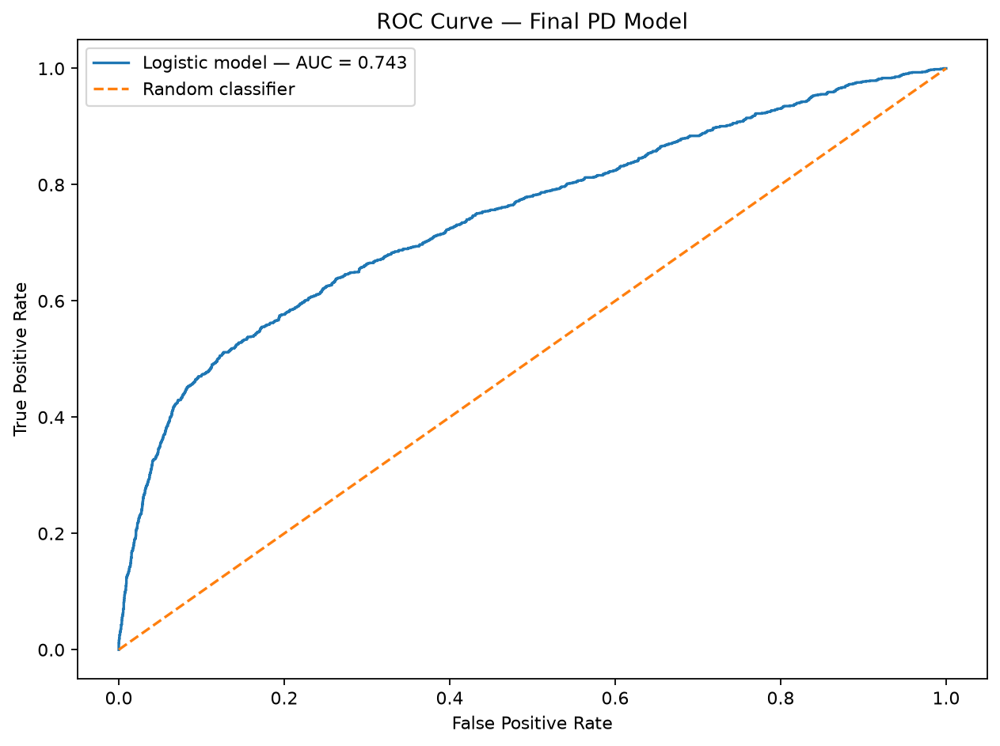
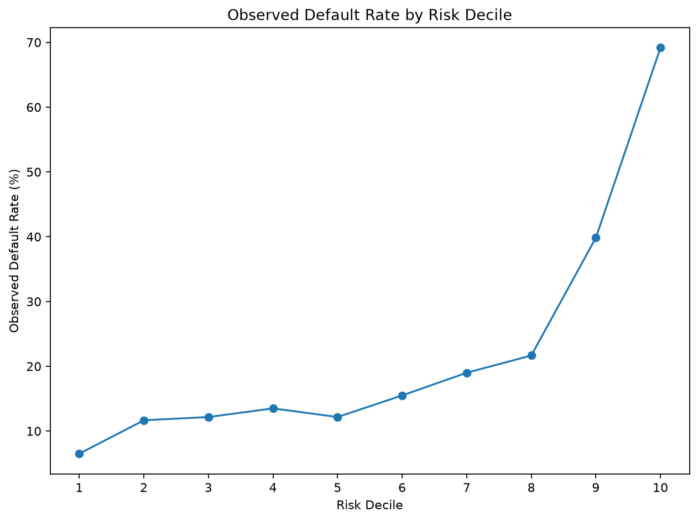

# Modelo de Probabilidad de Incumplimiento en Python

Proyecto de analítica de riesgo de crédito orientado al desarrollo, validación e interpretación de un modelo exploratorio de probabilidad de incumplimiento (PD).

El proyecto utiliza datos públicos del conjunto **Default of Credit Card Clients**, disponible en el UCI Machine Learning Repository.

La solución incluye:

- auditoría de calidad de datos;
- construcción de variables de comportamiento crediticio;
- división estratificada en entrenamiento, validación y prueba;
- regresión logística interpretable;
- comparación entre un modelo completo y uno parsimonioso;
- evaluación de discriminación y calibración;
- análisis por deciles de riesgo;
- cálculo de PSI;
- generación reproducible de métricas y gráficos.

## Objetivo

Estimar la probabilidad de que un cliente incumpla durante el siguiente periodo utilizando información demográfica, límite de crédito, comportamiento de pago, facturación y pagos históricos.

La unidad de análisis es el cliente y la variable objetivo es:

- `default = 1`: cliente en incumplimiento;
- `default = 0`: cliente sin incumplimiento.

## Fuente de datos

Se utilizó el conjunto público **Default of Credit Card Clients** del UCI Machine Learning Repository.

Características principales:

- 30.000 clientes;
- 25 variables originales;
- seis meses de comportamiento de pago;
- tasa de incumplimiento observada de 22,12%.

Los archivos crudos y procesados no se redistribuyen dentro del repositorio. El script de descarga permite obtener nuevamente los datos desde la fuente pública.

## Flujo metodológico

```text
Descarga de datos públicos
        ↓
Auditoría de calidad
        ↓
Recodificación y feature engineering
        ↓
División train / validation / test
        ↓
Preprocesamiento
        ↓
Regresión logística
        ↓
Selección del modelo parsimonioso
        ↓
Evaluación independiente
        ↓
Deciles, calibración y PSI
```

## Calidad de datos

Se validaron:

- número de filas y columnas;
- duplicados completos;
- unicidad del identificador;
- valores faltantes;
- integridad de la variable objetivo;
- rangos numéricos;
- códigos categóricos no documentados.

Resultados principales:

- 30.000 clientes;
- 30.000 identificadores distintos;
- 0 clientes duplicados;
- 0 valores faltantes;
- 6.636 incumplimientos observados.

## Construcción de variables

Las variables históricas fueron resumidas a nivel cliente.

### Comportamiento de pago

- atraso reciente;
- atraso severo reciente;
- meses con atraso;
- meses con atraso severo;
- máximo atraso observado;
- meses con factura positiva y pago igual a cero.

### Actividad financiera

- facturación promedio;
- pago promedio;
- utilización promedio del límite de crédito.

### Tratamiento de utilización

Los valores negativos y extremos se conservaron mediante banderas específicas.

La variable continua de utilización fue limitada al percentil 99 calculado exclusivamente con la muestra de entrenamiento:

```text
Percentil 99 de entrenamiento = 1,044127
```

Esto evita que observaciones extremas dominen la regresión y reduce el riesgo de fuga de información.

## División de muestras

La población fue dividida aleatoriamente y de manera estratificada:

| Muestra | Clientes | Defaults | Default rate |
|---|---:|---:|---:|
| Entrenamiento | 18.000 | 3.982 | 22,12% |
| Validación | 6.000 | 1.327 | 22,12% |
| Prueba | 6.000 | 1.327 | 22,12% |

La muestra de prueba se mantuvo separada durante el desarrollo y fue utilizada únicamente después de seleccionar el modelo final.

## Preprocesamiento

Las variables fueron tratadas según su naturaleza:

- categóricas: one-hot encoding;
- numéricas: estandarización;
- binarias: conservación como 0 y 1.

El preprocesamiento fue ajustado exclusivamente con la muestra de entrenamiento.

## Selección del modelo

Se compararon dos regresiones logísticas:

- modelo completo: 17 variables originales;
- modelo parsimonioso: 12 variables originales.

El modelo parsimonioso fue seleccionado porque mantuvo un desempeño similar con:

- menor redundancia;
- mayor facilidad de interpretación;
- menor brecha entre entrenamiento y validación;
- mayor facilidad de monitoreo y mantenimiento.

## Resultados de validación

| Métrica | Resultado |
|---|---:|
| AUC | 0,7563 |
| Gini | 0,5127 |
| O/E | 1,0126 |
| Brier Score | 0,1389 |
| Brier Skill Score | 19,37% |

## Evaluación final en prueba

| Métrica | Resultado |
|---|---:|
| AUC | 0,7431 |
| Gini | 0,4861 |
| KS | 0,3852 |
| Default observado | 22,1167% |
| PD promedio estimada | 22,1526% |
| O/E | 0,9984 |
| Brier Score | 0,1396 |
| Brier Skill Score | 18,95% |
| PSI train vs. test | 0,0011 |

El O/E cercano a uno indica que la PD promedio se encuentra prácticamente alineada con la tasa de incumplimiento observada.

El Brier Skill Score positivo indica que el modelo reduce aproximadamente 19% el error probabilístico frente a una predicción constante basada en la tasa de default de entrenamiento.

## Visualizaciones

### Curva ROC



### Tasa de incumplimiento por decil



### Calibración por deciles


## PSI

El PSI del score entre entrenamiento y prueba fue aproximadamente:

```text
PSI = 0,0011
```

Esto muestra distribuciones muy similares entre ambas muestras.

Sin embargo, la comparación no representa estabilidad temporal real, porque entrenamiento y prueba proceden de una división aleatoria del mismo dataset.

## Estructura del repositorio

```text
credit-risk-pd-model-python/
│
├── data/
│   ├── raw/                 # Datos originales, no publicados
│   └── processed/           # Bases procesadas, no publicadas
│
├── docs/
│   ├── methodology.md
│   └── limitations.md
│
├── notebooks/
│
├── outputs/
│   ├── figures/             # Gráficos finales
│   ├── models/              # Pipeline local, no publicado
│   └── tables/              # Métricas y resultados agregados
│
├── private_notes/           # Notas privadas, no publicadas
│
├── src/
│   ├── 01_download_uci_data.py
│   ├── 02_data_quality_audit.py
│   ├── 03_prepare_modeling_dataset.py
│   ├── 04_train_final_pd_model.py
│   ├── 05_evaluate_final_model.py
│   └── 06_create_final_figures.py
│
├── .gitignore
├── README.md
└── requirements.txt
```

## Reproducción del proyecto

### 1. Crear el entorno virtual

```powershell
py -m venv .venv
```

### 2. Instalar dependencias

```powershell
.\.venv\Scripts\python.exe -m pip install -r requirements.txt
```

### 3. Ejecutar el flujo completo

```powershell
.\.venv\Scripts\python.exe .\src\01_download_uci_data.py
.\.venv\Scripts\python.exe .\src\02_data_quality_audit.py
.\.venv\Scripts\python.exe .\src\03_prepare_modeling_dataset.py
.\.venv\Scripts\python.exe .\src\04_train_final_pd_model.py
.\.venv\Scripts\python.exe .\src\05_evaluate_final_model.py
.\.venv\Scripts\python.exe .\src\06_create_final_figures.py
```

El proceso genera nuevamente:

- datasets de entrenamiento, validación y prueba;
- pipeline final;
- coeficientes y odds ratios;
- métricas de validación;
- métricas de prueba;
- deciles de riesgo;
- PSI;
- gráficos finales.

## Principales archivos de resultados

```text
outputs/tables/final_model_validation_metrics.csv
outputs/tables/final_model_coefficients.csv
outputs/tables/final_test_metrics.csv
outputs/tables/final_test_decile_summary.csv
outputs/tables/score_psi_by_band.csv
outputs/tables/score_psi_summary.csv
```

El pipeline entrenado se almacena localmente en:

```text
outputs/models/final_pd_pipeline.joblib
```

Este artefacto está excluido del repositorio mediante `.gitignore`.

## Interpretación

Las señales principales identificadas por el modelo están relacionadas con:

- atraso reciente severo;
- persistencia de atrasos;
- meses con facturación positiva y pago cero;
- nivel promedio de pagos;
- capacidad crediticia.

Los coeficientes se interpretan como asociaciones condicionales, no como relaciones causales.

## Documentación

La explicación completa del proceso se encuentra en:

- `docs/methodology.md`: metodología, decisiones y resultados;
- `docs/limitations.md`: alcance, restricciones y uso previsto.

## Limitaciones

El proyecto utiliza datos públicos de clientes de tarjetas de crédito de Taiwán y no representa necesariamente una entidad financiera colombiana.

La división de muestras no es temporal y no existe una validación out-of-time.

El modelo es exploratorio y educativo. No constituye un modelo regulatorio ni debe utilizarse para tomar decisiones reales de aprobación, límites, provisiones o capital.
