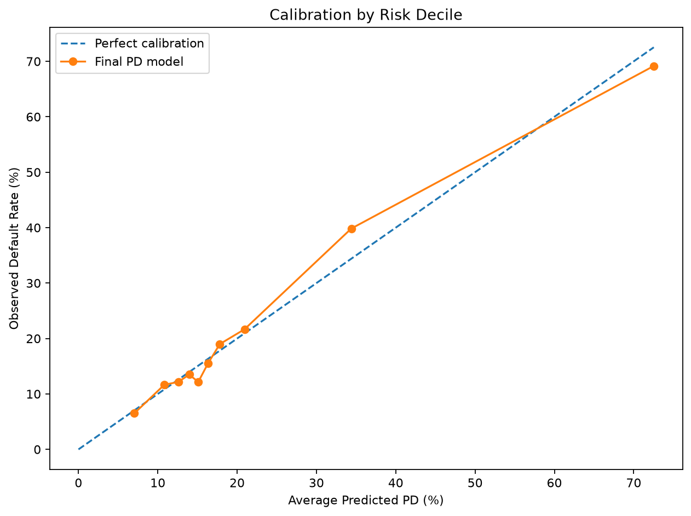

# Probabilidad de incumplimiento con regresión logística

Este proyecto estima la probabilidad de que un cliente de tarjeta de crédito incumpla el pago del mes siguiente. Trabaja con 30.000 clientes de Taiwán y seis meses de historial de facturación, pagos y atrasos. El modelo final utiliza 12 variables. [Datos de UCI](https://archive.ics.uci.edu/dataset/350/default+of+credit+card+clients) · [Metodología](docs/methodology.md)

## Qué tan bien funciona

En la muestra de prueba, **1.327 de 6.000 clientes incumplieron**. El modelo asignó probabilidades más altas a quienes terminaron incumpliendo con un AUC de **0,7431**. Para comprobar si esas probabilidades guardan relación con lo observado, también se compararon los resultados por decil.

| Métrica de prueba | Resultado |
|---|---:|
| AUC | 0,7431 |
| Gini | 0,4861 |
| KS | 0,3852 |
| Tasa de incumplimiento observada | 22,12 % |
| Probabilidad media estimada | 22,15 % |
| Razón observado/esperado | 0,9984 |
| Puntuación de Brier | 0,1396 |

El promedio estimado queda cerca del observado, aunque hay diferencias dentro de los grupos. Por ejemplo, en el noveno decil el modelo estimó **34,39 %** y se observó **39,83 %**. Cada decil de prueba contiene 600 clientes. [Métricas completas](outputs/tables/final_test_metrics.csv) · [Resultados por decil](outputs/tables/final_test_decile_summary.csv)



[Curva ROC](outputs/figures/final_test_roc_curve.png) · [Incumplimiento observado por decil](outputs/figures/final_test_default_rate_by_decile.png)

## Cómo se entrenó

La división fue aleatoria y estratificada por incumplimiento. Se asignaron 18.000 clientes a entrenamiento, 6.000 a validación y 6.000 a prueba. El límite superior de utilización del crédito se obtuvo del entrenamiento. La regresión logística, la codificación de categorías y la estandarización también se ajustaron en esa muestra. El AUC fue 0,7563 en validación y 0,7431 en prueba. La división aleatoria deja abierta la pregunta de cómo funcionaría el modelo en otro periodo. [División de las muestras](outputs/tables/sample_split_summary.csv) · [Resultados de validación](outputs/tables/final_model_validation_metrics.csv) · [Limitaciones](docs/limitations.md)

## Reproducir el análisis

El entorno utilizado fue Python 3.14.6. Desde la raíz del repositorio, ejecuta estos bloques en la misma terminal de PowerShell. El primer script descarga el conjunto 350 de UCI y guarda el CSV y su diccionario en `data/raw/`.

```powershell
py -m venv .venv
$python = ".\.venv\Scripts\python.exe"
& $python -m pip install -r requirements.txt
```

```powershell
& $python .\src\01_download_uci_data.py
& $python .\src\02_data_quality_audit.py
& $python .\src\03_prepare_modeling_dataset.py
& $python .\src\04_train_final_pd_model.py
& $python .\src\05_evaluate_final_model.py
& $python .\src\06_create_final_figures.py
```

Las métricas se escriben en `outputs/tables/`, las figuras en `outputs/figures/` y el modelo entrenado en `outputs/models/final_pd_pipeline.joblib`. Para revisar los resultados publicados sin ejecutar el entrenamiento, empieza por las métricas de prueba y los coeficientes. [Métricas de prueba](outputs/tables/final_test_metrics.csv) · [Coeficientes](outputs/tables/final_model_coefficients.csv)
